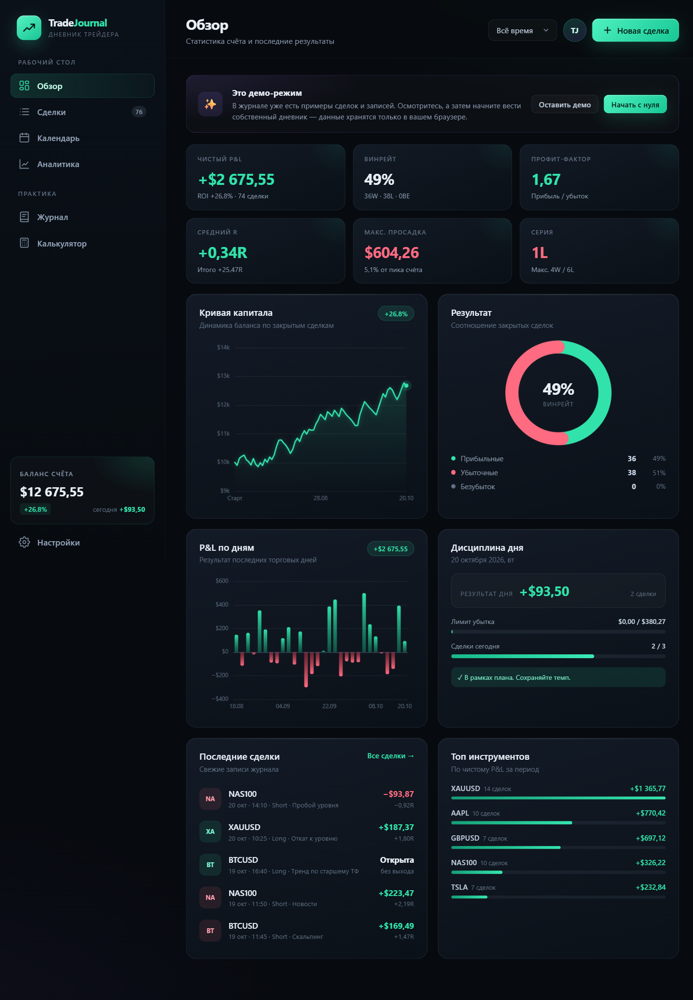
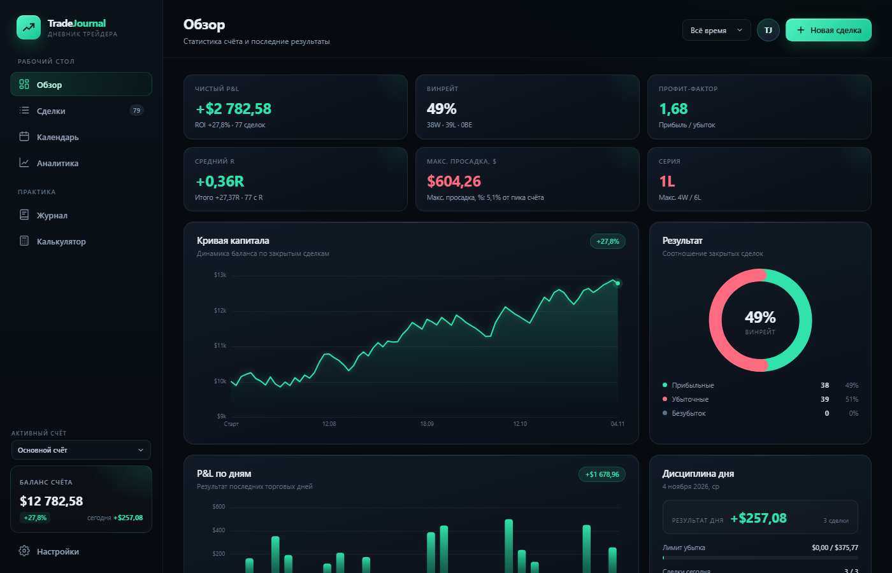
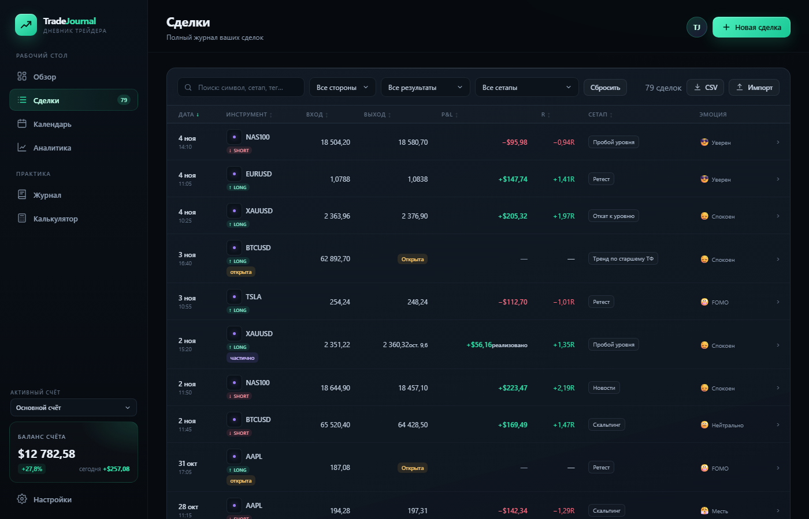
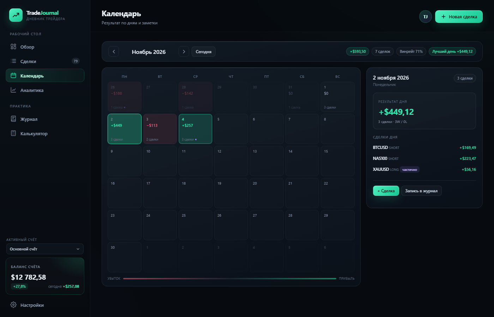
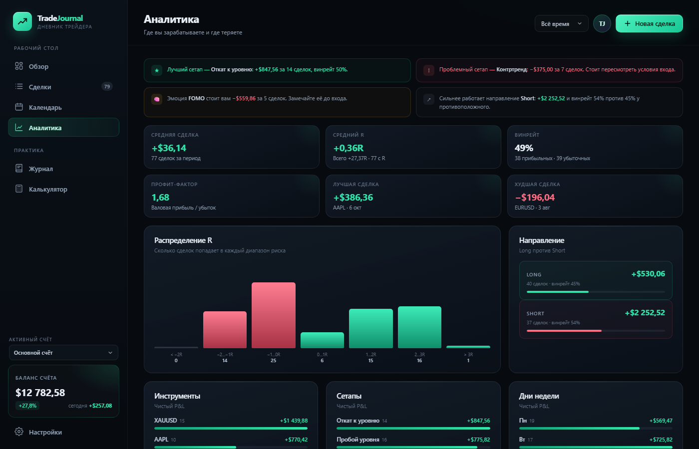
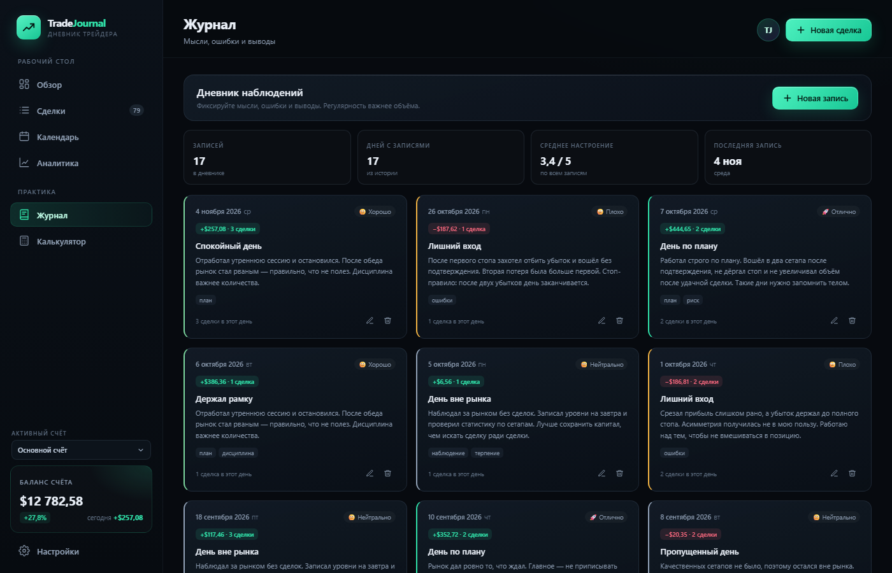
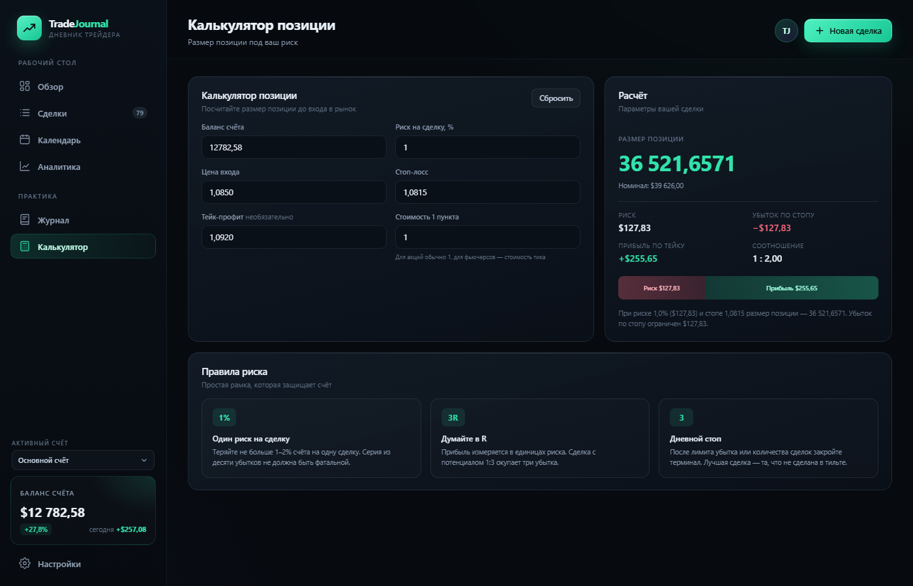
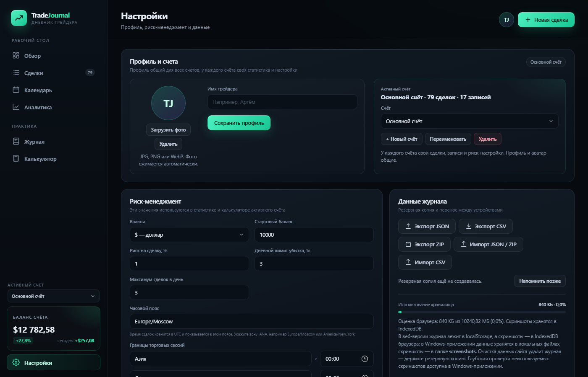
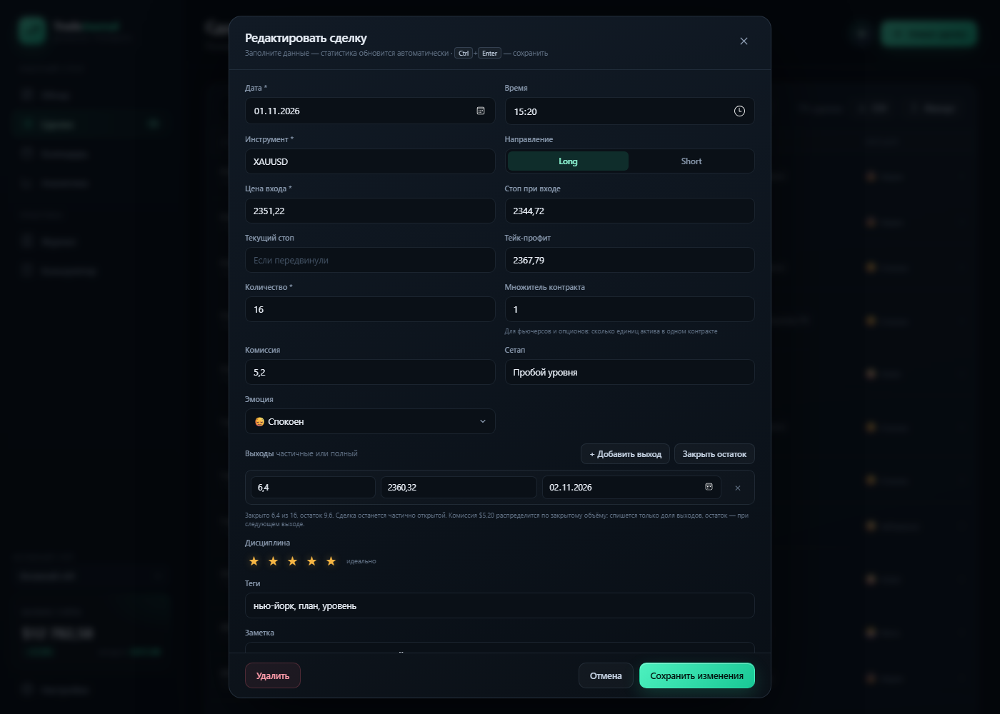

# TradeJournal — trading journal

English | [Русский](README.ru.md)

[](#ai-assisted-development)

> **AI-assisted development.** The code, tests, and documentation are created with extensive AI assistance and reviewed by the maintainer. [Details](#ai-assisted-development).

A local-first trading journal in three editions:

- **Windows app** — a lightweight installer built with Tauri 2 and Rust, with the same interface and file-based data storage.
- **macOS app** — a universal build for Apple Silicon and Intel with the same interface, storage layout, and offline operation.
- **Web version** — a static page with no server that can be opened in a browser or published on GitHub Pages.

> The app interface is available in Russian and English; Russian is the default. This README is available in both languages.

[Download the latest version](https://github.com/FamaSALO/tradejournal/releases/latest)



## Technology and architecture

The app uses no UI frameworks or interface bundler: the same interface is written in HTML5, CSS3, and vanilla JavaScript. The `index.html`, `css/`, and `js/` files work as a regular web page and are loaded inside the desktop app.

- **Windows shell** — Tauri 2 and Rust. The window, file storage, backups, and system dialogs live in `src-tauri/src/lib.rs`.
- **WebView2** — the app uses Microsoft Edge WebView2, the system component, instead of a bundled browser. This keeps the installer and installation folder small.
- **UI-to-system bridge** — Tauri `invoke` through `js/desktop-bridge.js`. The UI has no access to Node.js and can only call commands registered in Rust.
- **Security** — Content Security Policy, Tauri permissions in `src-tauri/capabilities/default.json`, no remote content loading, and atomic file writes.
- **Charts** — custom Canvas 2D rendering without third-party libraries.
- **Storage** — JSON files in `%APPDATA%\TradeJournal`: atomic writes, `journal.previous.json`, automatic and manual backups, and a separate `screenshots/` folder for images. In the web version, the journal is stored in `localStorage` and screenshots in IndexedDB. Data schema v4; v1, v2, and v3 journals are migrated automatically without losing trades, notes, or screenshots.
- **Build** — Tauri CLI 2.12, stable Rust, and an NSIS installer for Windows x64. CI builds run on `windows-latest` in GitHub Actions.
- **Publishing** — GitHub Pages for the web version and GitHub Releases for Windows builds.

```text
index.html + css/ + js/          interface
            │
            │ window.tradeJournalDesktop
            ▼
js/desktop-bridge.js             Tauri invoke + save queue
            ▼
src-tauri/src/lib.rs             Rust: window, files, backups, dialogs
            ▼
%APPDATA%\TradeJournal\          journal.json, screenshots/, backups/
```

## Features

- **Overview** — net P&L, win rate, profit factor, average R, drawdown, trade streaks, equity curve, and daily P&L. Partially closed positions are counted by their realized portion.
- **Daily result** — daily P&L, the calendar, the equity curve, and daily limits are calculated by exit date; the trade list and period filters use the entry date.
- **Trades** — add, edit, and delete trades; filters, search, and sorting; screenshots with clipboard paste (`Ctrl+V`), drag-and-drop, and a full-screen viewer; automatic P&L, R, and RR calculation. R is calculated from the initial stop; the current stop is stored separately. In the web version, screenshots are stored in IndexedDB, so the journal in `localStorage` stays compact.
- **Contract multiplier** — for futures and options: P&L and risk are multiplied by the number of units of the asset in the contract. The multiplier defaults to 1.
- **Partial exits and open positions** — multiple exits with their own quantity, price, and date; a **Close remaining** button; **Open** and **Partially closed** statuses; remaining position size and realized P&L. Commission is allocated by volume: a partially closed position carries only the share of the commission for the closed volume, and the remainder is charged on the next exit. After the update, P&L of saved partially closed trades may be recalculated downward.
- **Thumbnails and pagination** — the screenshot is visible directly in the trade row, and the journal is split into pages while preserving filters and sorting.
- **CSV import** — preview before adding, Russian and English headers, `;`, `,`, and tab separators, quotes, BOM, numbers and dates in various formats, partial exits in the `quantity@price|quantity@price` format, duplicate skipping, and import cancellation.
- **ZIP import** — the **Import JSON / ZIP** button accepts both JSON and a TradeJournal ZIP export: the app extracts `journal.json` from the archive itself and shows the same preview. Compressed Deflate entries are unpacked with the built-in `DecompressionStream`; files are read from memory and are not written to disk under names from the archive.
- **Calendar** — a profit heatmap by day with detailed statistics for the selected day.
- **Analytics** — R distribution, breakdown by instrument, setup, day of week, emotion, and trading session; a setup performance table; and automatic insights.
- **Time zone and trading sessions** — trade time is stored in UTC and displayed in the journal in the selected IANA time zone. The boundaries and names of the four sessions are configured in **Settings → Risk management**; sessions are calculated in the same time zone.
- **Journal** — notes with mood, tags, and consistency statistics.
- **Calculator** — position size, risk per trade, stop loss, and take profit.
- **Settings** — trader profile with an avatar, multiple named accounts with their own trades, notes, and risk settings; starting balance, risk, daily limits, currency, time zone, trading session boundaries, CSV/JSON export, a ZIP archive with screenshots, CSV/JSON import, demo data, and cleanup.
- **ZIP backups** — the archive contains `journal.json` with embedded screenshots and a `README.txt` with restore instructions. One file moves the entire journal to another device.
- **PWA and offline** — the web version can be installed as an app from the browser; a service worker caches the interface, and an update banner with an **Update** button appears when a new version is available.
- **Windows auto-update** — the app checks for signed updates in GitHub Releases, downloads the installer, and restarts. A check can also be started manually in settings.
- **Interface language and themes** — Russian and English interfaces, dark and light themes, accent presets or a custom accent, and custom background and panel colors in **Settings → Interface**. Changes are saved on the device; notes, journal entries, account names, symbols, and setups are never translated.
- **Drafts** — the trade form automatically saves unsaved changes, restores them when reopened, and warns when closing. Drafts are tied to an account and a trade.
- **Discipline and emotions** — an execution quality score and analysis of how psychology affects results.
- **Responsive layout** — a separate layout for phones in the web version.

Keyboard shortcuts: `N` — new trade, `/` — search, `Esc` — close a window, `Ctrl+V` — paste a screenshot into an open trade editor, `Ctrl+Enter` or `Ctrl+S` — save the trade.

## Interface language and appearance

Open **Settings → Interface**:

- **Language** — Russian or English. The interface reloads after switching; Russian is the default. Only interface labels are translated. User content — notes, journal entries, account names, symbols, and setups — is shown exactly as entered.
- **Theme** — dark or light. The theme applies to the whole app, including charts and the calendar.
- **Interface colors** — a preset accent or any custom accent color, plus custom background and panel colors. Profit and loss colors stay green and red regardless of the accent.
- **Reset appearance** — returns the theme and colors to their defaults without changing the selected language.

Preferences are stored locally in the browser or desktop app and do not affect the journal, screenshots, or backups.

## Screenshots

The screenshots use generated demo data; no real journal is shown.

| Overview | Trades |
| --- | --- |
|  |  |
| Key metrics, equity curve, and daily P&L | Filters, partial exits, and open positions |

| Calendar | Analytics |
| --- | --- |
|  |  |
| Daily P&L heatmap and the selected day's trades | R distribution and performance breakdowns |

| Journal | Calculator |
| --- | --- |
|  |  |
| Notes with mood, tags, and consistency statistics | Position size, risk, stop loss, and take profit |

| Settings | Trade editor |
| --- | --- |
|  |  |
| Accounts, risk management, data, and updates | Partial exits, R/RR, screenshots, and notes |

## What's new in 2.4.0

- **Daily result** — daily P&L, the calendar, and daily limits are now calculated by exit dates; a trade with multiple partial exits is distributed across days.
- **Drawdown** — maximum drawdown is shown separately in money and as a percentage of the account peak.
- **Commissions** — when a position is partially closed, only the share of the commission for the closed volume is charged; the remainder is charged on the next exit.
- **Screenshots in the web version** — stored in IndexedDB, migrated from old journals, embedded in exports, and restored on import. Settings now include a storage estimate and a request for persistent access.
- **Backups** — the app remembers the date of the last export and, once per session, reminds you about a backup if there has not been one for more than 7 days.
- **Offline updates** — the service worker bypasses the HTTP cache during installation and fetches fresh files immediately.
- **Web metadata** — canonical URL, Open Graph and Twitter cards, a 512 maskable icon, and an updated PWA manifest.
- **Reliability** — time zone tests across DST transitions, app shell integrity checks, ESLint, and a separate CI for web checks.
- **ZIP import** — a ZIP backup can be restored directly through **Import JSON / ZIP**, without manually extracting `journal.json`; stored and Deflate entries are supported, and CRC-32, sizes, and name safety are checked.
- **Releases** — a tag build publishes a draft GitHub Release; auto-update for users is enabled only after manual verification and clicking **Publish**.
- **License** — the project is distributed under the MIT License.

## Windows app

### Installation

The GitHub Release contains:

- `TradeJournal_2.4.0_x64-setup.exe` — an NSIS installer for the current user, without administrator rights.
- `TradeJournal_2.4.0_x64-setup.exe.sig` — the installer signature for auto-update.
- `TradeJournal-portable-2.4.0-x64.zip` — a portable version that runs without installation.
- `latest.json` — the update manifest read by the Windows app.
- `SHA256SUMS.txt` — file checksums.

The installer is not signed with a certificate. On first launch, Windows SmartScreen may show a warning: choose **More info → Run anyway**. This is expected for a build without a paid code-signing certificate.

If WebView2 is missing from the system, the installer downloads and installs it. The portable version requires WebView2 to be already installed — it is usually present with Microsoft Edge on Windows 10 and 11.

On first launch, the app shows a demo journal. Data from the web version or the old Electron version can be migrated through **Settings → Export JSON** and then **Settings → Import JSON / ZIP**. The import button accepts both JSON and a ZIP export: `journal.json` is extracted from the archive automatically. Before replacing the journal, the app shows a dry-run report: how many current trades will be replaced and how many trades from the file will be skipped, with reasons — for example, "no symbol: 2, invalid date: 1". Trades without a symbol or with an invalid date are not imported, so they cannot silently take today's date; other accounts, trades, notes, and screenshots are imported with warnings about losses. If `%APPDATA%\TradeJournal\journal.json` already exists, the app automatically migrates the old format to the new one: previous settings, trades, and notes go into the **Main account**, and embedded screenshots are moved to the `screenshots` folder.

### Auto-update

The Windows app checks for updates at startup and can update without manually downloading the installer:

- The update source is GitHub Releases of the `FamaSALO/tradejournal` repository, with the `latest.json` manifest at `https://github.com/FamaSALO/tradejournal/releases/latest/download/latest.json`.
- The app compares versions and only offers a newer build. A manual check is available in **Settings → App and local files → Check for updates**. If an update is found, a **Download and install** button appears next to it — it downloads and installs the new version immediately, just like the button in the top banner.
- The installer is downloaded in the background, verified against the embedded public key, and launched with an app restart. A corrupted or foreign signature is rejected.
- If there is no network or GitHub is unavailable, the app keeps working and shows an error only during a manual check.
- The portable version does not use auto-update: unpack the new ZIP over the old folder while keeping `%APPDATA%\TradeJournal`.
- The private signing key is stored only in GitHub Actions Secrets (`TAURI_SIGNING_PRIVATE_KEY`, `TAURI_SIGNING_PRIVATE_KEY_PASSWORD`) and never enters the repository.
- macOS builds do not use this updater yet; update them manually as described in [macOS app](#macos-app).

### Size and resource usage

Measurements on Windows 11 x64 with a 77-trade journal, right after launch:

| Metric | Electron 1.0.0 | Tauri 2.0.0 |
| --- | ---: | ---: |
| Installer | 112.8 MB | 1.2 MB |
| Installed folder | 357.7 MB | 3.2 MB |
| Process working set | ≈ 497 MB | ≈ 417 MB |
| Process private memory | ≈ 352 MB | ≈ 270 MB |

The installed Tauri folder contains only `tradejournal.exe` and the uninstaller. The WebView2 browser engine is already part of Windows and is not duplicated in the app; Electron bundled its own copy of Chromium. The WebView2 service cache takes about 70 MB in `%LOCALAPPDATA%\com.famasalo.tradejournal` and is created on first launch.

RAM usage depends on the WebView2 version, the open section, and the amount of data, so the figures above are a guide, not a hard guarantee.

### Where data is stored

The desktop app does not use the browser's `localStorage`. The journal lives in a separate user folder:

```text
%APPDATA%\TradeJournal\
├── journal.json            main journal file (profile, accounts, trades, notes)
├── journal.previous.json   previous version of the file
├── screenshots\            trade screenshot files
└── backups\                backups
```

- The path and the **Open data folder**, **Create backup**, and **Restore** buttons are in **Settings → App and local files**.
- An automatic backup is created on save, but no more than once every 10 minutes. A manual backup can be created at any time.
- The last 20 automatic and manual backups are kept. Before a restore, the current state is also saved as a separate backup.
- Screenshots are stored as separate files in `screenshots/`, and `journal.json` keeps only references. Images retain detail: in the desktop app, up to 2560 px without quality loss (PNG) or in high-quality WebP; in the web version, up to 1920 px in WebP. When a screenshot is deleted or replaced, the old file is not removed automatically, so restored backups continue to work.
- **Settings → App and local files → Storage health** shows how much space the journal, screenshots, previous version, and backups use. **Scan** also finds files not referenced by `journal.json`, `journal.previous.json`, or any backup. Only such unused files can be deleted; the list and size are shown before deletion, and references are checked again immediately before cleanup.
- Uninstalling the app does not delete the journal, screenshots, or backups. On Windows the data remains in `%APPDATA%\TradeJournal`; on macOS, in `~/Library/Application Support/TradeJournal`.
- The entire `TradeJournal` folder can be copied to another computer to move the journal with screenshots and backup history.
- The WebView2 service cache is stored separately in `%LOCALAPPDATA%\com.famasalo.tradejournal` and does not contain journal data.
- Starting with 2.2.0, `journal.json` uses schema v3: a trade has `multiplier` and an `exits` array. When an old file is opened, the previous single `exit` becomes the only partial exit, and a fully closed trade keeps the weighted exit price. A regular backup is created before migration.
- Starting with 2.3.0, schema v4 is used: trade time is stored in UTC in `timeUtc`, while `date` and `time` remain the local representation in the account's time zone. Account settings contain `timezone` and a `sessions` array with session names and start times. When a v3 schema is opened, the previous local date and time are converted to UTC in the system time zone; when the time zone changes, date and time are recalculated from `timeUtc`.

### Build

Requirements:

- Node.js 22.12+ and npm;
- stable Rust with the MSVC toolchain (`rustup default stable-x86_64-pc-windows-msvc`);
- Visual Studio Build Tools with the **Desktop development with C++** component and the Windows SDK;
- Microsoft Edge WebView2 Runtime to run the app.

On Windows, use `npm.cmd` if PowerShell blocks `npm.ps1`.

```powershell
npm.cmd install
npm.cmd run dev
```

Build the installer:

```powershell
npm.cmd run build
```

The finished installer and executable appear here:

```text
src-tauri\target\release\TradeJournal.exe
src-tauri\target\release\bundle\nsis\TradeJournal_2.4.0_x64-setup.exe
```

The portable build is produced by packing `TradeJournal.exe` into a ZIP. This is what the CI build in `.github/workflows/tauri.yml` does.

Checks before building:

```powershell
npm.cmd test                  # node:test for storage, CSV, ZIP, and PWA
npm.cmd run check:versions    # version must match in all files
cargo fmt --check --manifest-path src-tauri/Cargo.toml
npm.cmd run web:build         # prepare dist/ for Tauri and cargo test
cargo test --manifest-path src-tauri/Cargo.toml
```

`npm.cmd run web:build` copies the interface, `manifest.webmanifest`, `sw.js`, and PWA icons into `dist/`. CI also runs the same checks, builds the installer with the update signature, and generates `latest.json` and `SHA256SUMS.txt`.

If MSVC Build Tools are not installed locally, use the ready CI build: push changes to the `main` branch, wait for the **Build Tauri app** workflow to finish, and download the artifact.

### Release

A release is published automatically from a tag:

```powershell
git tag v2.4.0
git push origin v2.4.0
```

The tag must match the version in `package.json`: version `2.4.0` requires tag `v2.4.0`. If they differ, the workflow fails. A tag build runs the **Build Tauri app** workflow, builds the installer and all artifacts, and then creates a draft GitHub Release with the installer, `.sig` signature, portable ZIP, `latest.json`, and `SHA256SUMS.txt`. A regular push to `main` builds artifacts but does not create a draft. If a draft or published release already exists for the tag, the workflow does not overwrite it and fails.

Until the draft is published with **Publish**, the links in `latest.json` are not visible to users and auto-update from 2.3.0 to 2.4.0 is unaffected. After checking the files on Windows, publish the draft on the release page; users will receive the notification and can download and install the update. To roll back after publication, delete the release or publish a fixed version.

Before publishing, follow the [manual release checklist](docs/RELEASE-CHECKLIST.md) (in Russian).

## macOS app

The universal `TradeJournal_2.4.0_universal.dmg` runs on Apple Silicon and Intel Macs. It is built by the **Build macOS app** workflow in GitHub Actions and is available as a workflow artifact until the macOS build is added to a public release.

The current build is not signed or notarized with an Apple Developer certificate. On first launch, macOS may block it:

1. Open the DMG, drag **TradeJournal** to **Applications**, and try to launch it once.
2. Open **System Settings → Privacy & Security** and click **Open Anyway** next to TradeJournal.
3. If macOS still refuses to open the app, run `xattr -cr /Applications/TradeJournal.app` in Terminal.

Data is stored in `~/Library/Application Support/TradeJournal` with the same `journal.json`, `screenshots/`, and `backups/` layout as on Windows. The journal is not stored in the browser and survives replacing the app.

macOS builds currently update manually: download a new DMG from the releases page, replace the app in **Applications**, and keep the data folder. Auto-update remains Windows-only for now.

To build locally on macOS:

```bash
rustup target add aarch64-apple-darwin x86_64-apple-darwin
npm install
npm run tauri build -- --target universal-apple-darwin --bundles dmg
```

The DMG appears in `src-tauri/target/universal-apple-darwin/release/bundle/dmg/`. The workflow in `.github/workflows/macos.yml` also runs tests, clippy, and Rust tests before packaging.

## Web version

1. Download the project folder.
2. Open `index.html` in a browser.

The web version remains static: it needs no server, Node.js, or installed app. Demo data loads on first launch. You can remove it with the **Start from scratch** button on the home page.

### Install as an app and offline mode

- On GitHub Pages, the web version registers a service worker and caches the interface, styles, scripts, manifest, and icons. After the first visit, the journal works offline.
- The browser may offer to install TradeJournal as a separate app (Chrome/Edge: install icon in the address bar; Android: "Add to Home screen"; iOS Safari: "Add to Home Screen").
- The cache is versioned: when a new version is released, the service worker downloads the update in the background, and an **Update available** banner with an **Update** button appears in the UI.
- The service worker and PWA manifest work only when opened over HTTP(S) (GitHub Pages or a local server). Opening `index.html` directly via `file://` works as a regular page, but without offline caching and installation.
- Data is still stored only in the browser (journal in `localStorage`, screenshots in IndexedDB) and is not synchronized between devices.

## Data storage in the web version

The journal is stored in the browser's `localStorage` under the `tradejournal.v1` key; the stored value contains the current v4 schema with the profile, accounts, contract multiplier, partial exits, UTC trade times, time zone, and configurable trading sessions. Web-version screenshots are stored separately in IndexedDB under `idb:screenshots/<id>` references. Old v1, v2, and v3 schemas are read and migrated automatically on first open: local date and time of old trades are converted to UTC in the selected time zone, and embedded screenshots are moved to IndexedDB. Nothing is sent to a server.

- Unsaved trade-form drafts are stored separately under `tradejournal.draft.v1.<accountId>.<tradeId|new>`.
- Data is tied to the browser and page address: `file://` and GitHub Pages use different storage.
- Clearing site data deletes the journal and screenshots.
- The browser requests persistent storage for IndexedDB to reduce the risk of automatic eviction. The actual size and quota are shown in **Settings → Storage usage**, which displays the `navigator.storage.estimate()` estimate.
- For a backup, use **Settings → Export JSON**. Screenshots from IndexedDB are embedded in the export, so the file can be moved to another device; on import they are moved back to IndexedDB.
- After exporting JSON or ZIP, the app remembers the export date in `tradejournal.meta`. If no backup has been made for more than 7 days, a reminder is shown once per session at startup; it can be postponed. The last export date is visible in settings.
- If saved data is corrupted, the app does not overwrite it; it offers to download the original file and only then reset the journal.
- Deleting trades and notes, importing, loading demo data, and clearing can be undone immediately after the action via a button in the notification. This is short-term insurance, not a replacement for a backup.

## Project structure

```text
index.html                  App markup and modal windows
css/styles.css              Styles and responsive layout
js/utils.js                 Formatting, reference data, date handling
js/blobstore.js             IndexedDB screenshots and storage adapter
js/store.js                 Storage, v4 data model, and metric calculations
js/csv.js                   CSV parsing, delimiter detection, and import preview
js/zip.js                   ZIP archive creation without external libraries
js/pwa.js                   Service worker registration and update banner
js/desktop-bridge.js        Bridge between the UI and Tauri
js/sample.js                Demo data generator
js/charts.js                Canvas charts
js/app.js                   UI logic and routing
manifest.webmanifest        Installable web app manifest
sw.js                       Service worker with versioned cache
assets/icons/               PWA 192/512, maskable, and apple-touch-icon icons
assets/og-image.png         Open Graph and Twitter cover
src-tauri/src/lib.rs        Rust commands, file storage, backups, and updates
src-tauri/src/main.rs       Desktop app entry point
src-tauri/tauri.conf.json   Window, CSP, Windows bundle, and auto-update
src-tauri/tauri.macos.conf.json macOS bundle targets and icon
src-tauri/Cargo.toml        Rust dependencies and release optimization
src-tauri/capabilities/     Tauri permissions
scripts/build-web.mjs       Prepare dist/ for Tauri
scripts/check-versions.mjs  Check version consistency across files
tests/                      node:test for storage, CSV, ZIP, PWA, and metadata
.github/workflows/web.yml   CI: linter, tests, and web build
.github/workflows/tauri.yml CI: checks, tests, Windows build, and latest.json
.github/workflows/macos.yml CI: checks, tests, and universal macOS DMG
build/icon.ico              App icon
assets/screenshots/         README screenshots
assets/preview.png          README preview
```

## Publishing the web version to GitHub Pages

1. Upload the files to a GitHub repository.
2. Open **Settings → Pages**.
3. Under **Build and deployment**, select **Deploy from a branch**, the `main` branch, and the `/ (root)` folder.
4. Save the settings — the site will be available at `https://<username>.github.io/<repository>/`.

Windows build files are not published to GitHub Pages and are not committed to the repository.

## AI-assisted development

TradeJournal is developed with extensive AI assistance. AI coding assistants help with implementation, tests, documentation, and release automation. Every change is reviewed, tested on Windows, and published by the maintainer, who remains responsible for the project. AI is a development tool here, not an author or maintainer.

## License

The project is distributed under the MIT License. The full text is in [LICENSE](LICENSE). Copyright (c) 2026 FamaSALO.
